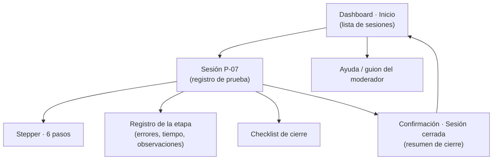

# Sitemap — Dashboard UX (IHC-A-12)

| Nivel | Pantalla | Componentes principales |
|---|---|---|
| 0 | Inicio | Card UI por sesión, badge de estado, botón "Retomar" |
| 1 | Sesión | Stepper, formulario de registro, Checklist Grid, indicador de guardado, "Cerrar sesión" |
| 2 | Confirmación | Estado "Sesión cerrada", resumen de pasos y checklist |

Navegación global: barra superior con migas de pan *Sesiones › P-07 › Cerrada*.
