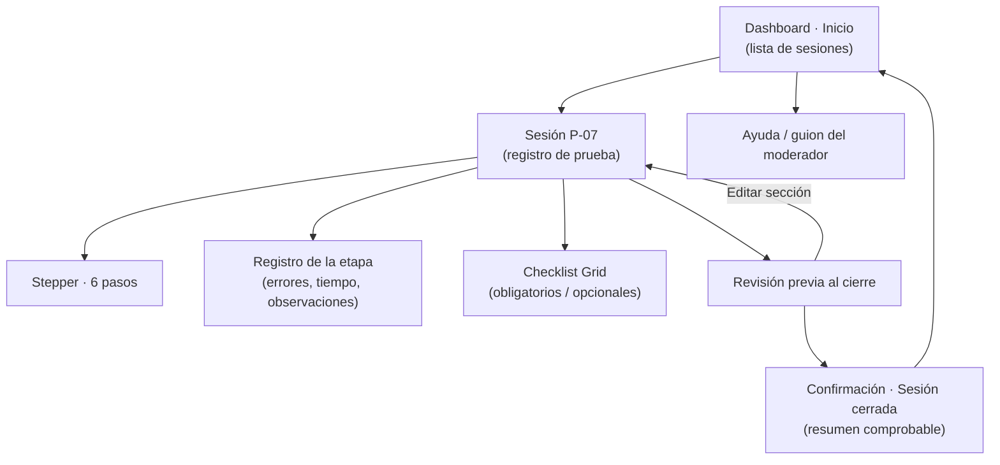

# Sitemap — Dashboard UX (IHC-A-12)

| Nivel | Pantalla | Componentes principales |
|---|---|---|
| 0 | Inicio | Card UI por sesión, badge de estado, botón "Retomar" |
| 1 | Sesión | Stepper, formulario de registro, Checklist Grid, indicador de guardado, "Cerrar sesión" |
| 2 | Revisión previa | Resumen por secciones con "Editar", "Confirmar cierre", "Volver" |
| 3 | Confirmación | Estado "Cerrada · verificada", código de verificación, "Comprobar de nuevo" |

Navegación global: barra superior con migas de pan *Dashboard › Sesión P-07 › Revisión*.
