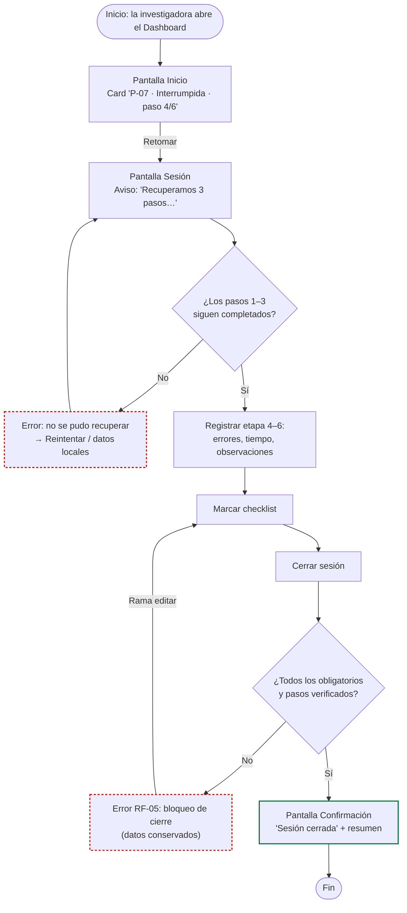

# User flow — Recuperar checklist y cerrar sesión

Leyenda (igual que en el repositorio CaféU): rectángulo = pantalla, rombo = decisión, borde rojo = error, borde verde = éxito.

## Ramas

| Rama | Recorrido | Requisitos |
|---|---|---|
| **Principal** | Inicio → Retomar → Sesión → registrar → checklist completo → Cerrar → Confirmación | RF-01, RF-02, RF-04, RF-06 |
| **Error / editar (checklist)** | Cerrar con pendientes → bloqueo con mensaje de error → editar checklist/pasos → Cerrar | RF-03, RF-05 |
