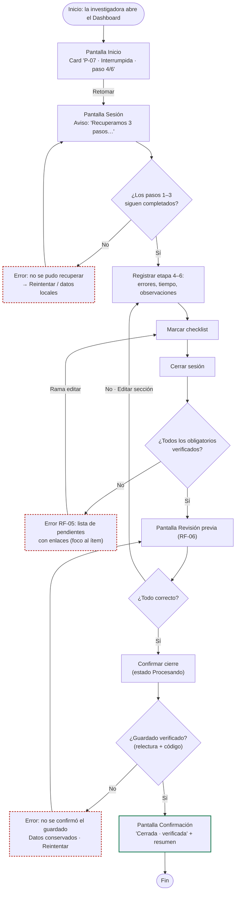

# User flow — Recuperar checklist y cerrar sesión

Leyenda (igual que en el repositorio CaféU): rectángulo = pantalla, rombo = decisión, borde rojo = error, borde verde = éxito.

## Ramas

| Rama | Recorrido | Requisitos |
|---|---|---|
| **Principal** | Inicio → Retomar → Sesión → registrar → checklist completo → Revisión → Confirmar → Confirmación | RF-01, RF-02, RF-04, RF-06 |
| **Error / editar (checklist)** | Cerrar con pendientes → error con lista → ir al ítem → marcar → Cerrar | RF-03, RF-05 |
| **Editar desde revisión** | Revisión → "Editar" sección → Sesión → Revisión | RF-06 (principio de confirmar/editar tomado de CaféU) |
| **Error de guardado** | Confirmar → verificación falla → error, datos conservados → Reintentar | RF-01, RF-06 |

> **Principio del repositorio complementario (CaféU):** el flujo de "Mi pedido" separa *editar* de *confirmar* y termina en una **confirmación visible** con identificador (`#CU-104`). Aquí la Revisión previa cumple el papel de "Mi pedido" y la Confirmación muestra el código de verificación de la sesión.

## Versión v1 (antes de la incidencia)

En v1 no existen los nodos *Revisión previa* ni *¿Guardado verificado?*: tras D2 = Sí se pasa directo a Confirmación. Fueron añadidos por la incidencia sorpresa (Issue #4).
