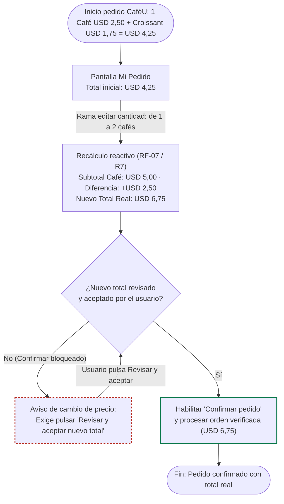

# User flow — Flujos actualizados por Incidencias (Dashboard UX `IHC-A-12` y CaféU `IHC-A-01`)

Leyenda: rectángulo = pantalla, rombo = decisión, borde rojo = error/revisión pendiente, borde verde = éxito verificado.

## 1. Caso Dashboard UX · Tarjeta `IHC-A-12` (Finalización prematura · Issue #4)

---

## 2. Caso CaféU · Tarjeta `IHC-A-01` (Precio cambia al editar · Issue #9 · Requisito `RF-07 / R7`)

> **Modificación en la rama de editar (`IHC-A-01`):** Cuando el usuario modifica la cantidad de cafés (de 1 a 2), el flujo invalida la confirmación directa, recalcula subtotales (`USD 2,50` → `USD 5,00`) y el total real (`USD 4,25` → `USD 6,75`), muestra la diferencia (`+USD 2,50`) y exige pasar por el nodo de decisión **`¿Nuevo total revisado y aceptado?`** antes de habilitar `Confirmar pedido`.

## Tabla de Ramas Integrada

| Caso Base | Rama | Recorrido | Requisitos | Issue |
|---|---|---|---|---|
| **Dashboard UX (`IHC-A-12`)** | Principal | Inicio → Retomar → Sesión → registrar → checklist completo → Revisión → Confirmar → Confirmación | RF-01, RF-02, RF-04, RF-06 | #1, #2, #4 |
| **Dashboard UX (`IHC-A-12`)** | Error / editar (checklist) | Cerrar con pendientes → error con lista → ir al ítem → marcar → Cerrar | RF-03, RF-05 | #1, #3 |
| **Dashboard UX (`IHC-A-12`)** | Error de guardado | Confirmar → verificación falla (`?fallo=1`) → error, datos conservados → Reintentar | RF-01, RF-06 | #4 |
| **CaféU (`IHC-A-01`)** | **Rama editar cantidad y precio** | Mi Pedido (`USD 4,25`) → Editar de 1 a 2 cafés → Recalcular subtotal/total (`USD 6,75`) y diferencia (`+USD 2,50`) → Bloquear confirmación hasta nueva revisión → Aceptar nuevo total → Confirmar | **RF-07 (`R7`)** | **#9** |
