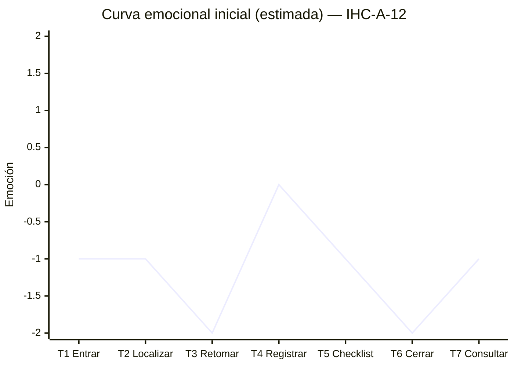

# Fase 1 · Diagnóstico emocional — Tarjeta IHC-A-12 (Dashboard UX)

| Campo | Valor |
|---|---|
| **Persona usuaria** | Investigadora UX que retoma una prueba de usabilidad interrumpida |
| **Tarea crítica** | Recuperar el checklist y cerrar la sesión de prueba |
| **Restricción** | No perder los pasos previamente finalizados |
| **Fallo específico** | El estado final ("Completado") aparece sin comprobar el checklist obligatorio |
| **Referencia base** | `maribelsailema/HCI_2026_G1` — Usability Test Plan Dashboard (Card UI, Stepper, checklist Grid, 7 touchpoints, 2 MdV) |
| **Referencia complementaria** | `Sax300-cpu/HCI-2026-G2` — rama **confirmar / editar** del user flow y **confirmación visible** (carpeta `presentacion/`) |

> **Separación estimación / observación.** Todo lo de este documento es **estimación heurística** (inspección del equipo sobre la interfaz de referencia y el escenario de la tarjeta). Lo **observado** con una persona real se registra únicamente en [`pruebas/sesion.md`](../pruebas/sesion.md).

## 1. Escenario

Lucía (persona ficticia), investigadora UX, moderaba la sesión del participante **P-07** cuando se cortó la energía del laboratorio en la **Tarea 2 (paso 4 de 6)**. Al día siguiente abre el Dashboard para terminar el registro y cerrar la sesión. Necesita confiar en que lo ya hecho sigue ahí y en que "Cerrada" significa realmente "completa".

## 2. Touchpoints (7)

| # | Touchpoint | Componente | Tipo | Emoción estimada (−2…+2) | Problema estimado |
|:-:|---|---|---|:-:|---|
| T1 | Entrar al Dashboard | Encabezado / lista de sesiones | Orientación | −1 | No se distingue qué sesión quedó interrumpida |
| T2 | Localizar la sesión pausada | Card UI de la sesión | Informacional | −1 | Sin indicador "interrumpida", ni fecha de último guardado |
| T3 | **Retomar y ver progreso** | Stepper (6 pasos) | Estado | **−2** | **MdV 1**: no se sabe si los pasos 1–3 se conservaron; temor a rehacer |
| T4 | Registrar etapa, errores y observaciones | Formulario de la tarea | Funcional | 0 | Campos sin guardado visible |
| T5 | Revisar checklist obligatorio | Checklist Grid | Verificación | −1 | Obligatorio vs. opcional no se diferencia |
| T6 | **Cerrar sesión** | Botón "Cerrar sesión" | Transaccional | **−2** | **MdV 2**: se muestra "Completado" aunque falten ítems obligatorios (éxito falso) |
| T7 | Consultar la sesión cerrada | Resumen / estado final | Confirmación | −1 | El estado final no es comprobable (sin resumen ni evidencia) |

## 3. Momentos de verdad

1. **MdV 1 — Retomar (T3):** la investigadora decide si confía en el sistema o vuelve a su libreta de papel. Si no ve los pasos finalizados conservados, rehace trabajo o abandona.
2. **MdV 2 — Cerrar (T6/T7):** el sistema declara "Completado". Si el checklist obligatorio no se verificó (consentimiento, grabación, SUS), la sesión queda inválida para el estudio y la investigadora lo descubrirá tarde: pérdida de confianza total.

## 4. Fallos priorizados (severidad Nielsen 0–4)

| ID | Fallo | Principio vulnerado | Severidad | Issue |
|---|---|---|:-:|---|
| F1 | Estado final "Completado" sin validar ítems obligatorios (éxito falso) | Nielsen #1 Visibilidad del estado, #5 Prevención de errores | **4** | #1 |
| F2 | Al retomar no se muestran los pasos ya finalizados ni el último guardado | Nielsen #6 Reconocer antes que recordar; **carga cognitiva** (memoria de trabajo: la usuaria debe recordar dónde quedó) | **3** | #2 |
| F3 | Ítems obligatorios y opcionales mezclados con el mismo aspecto | **Gestalt** — Similitud / Región común (lo distinto se ve igual) | **2** | #3 |

## 5. Curva emocional inicial (estimada)

Versión en imagen: [`evidencias/curva-antes.svg`](../evidencias/curva-antes.svg).

Lectura: los dos valles (−2) coinciden con los momentos de verdad; ningún touchpoint llega a satisfacción positiva porque el cierre no ofrece certeza.

## 6. Issues abiertos

Ver texto listo para publicar en [`evidencias/issues.md`](../evidencias/issues.md) (#1 F1, #2 F2, #3 F3 y #4 incidencia sorpresa).
