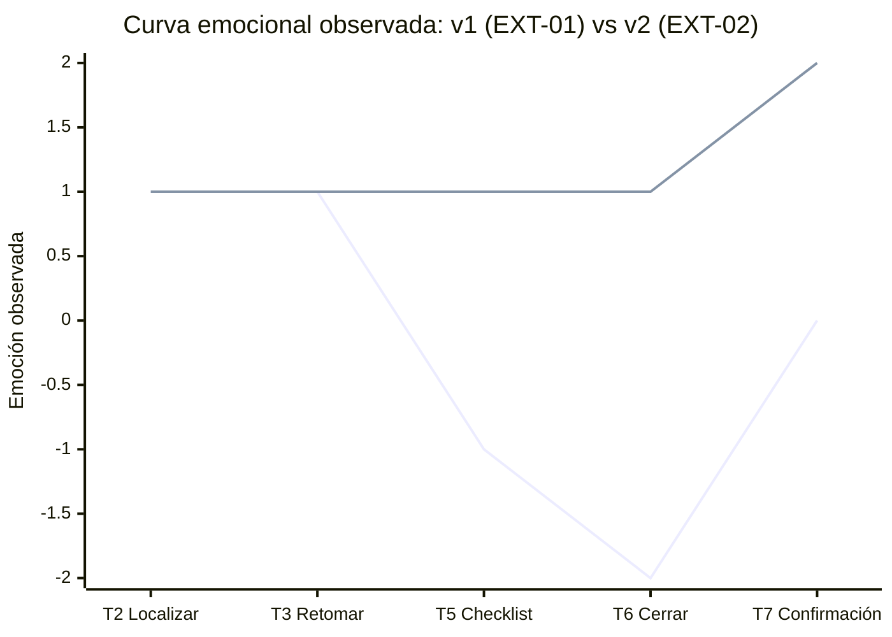

# Fase 4 · Prueba cognitiva (registro de sesión)

## Protocolo

| Campo | Valor |
|---|---|
| Fecha / hora | 28/10/2026 11:02 (v1) · 11:12 (re-prueba v2) |
| Participantes | `EXT-01` (estudiante del Equipo G2 — CaféU, prueba en v1) y `EXT-02` (estudiante del Equipo G3, re-prueba en v2) |
| Moderador / observador | Carlos Giovanni Ramos (@carlitosgiovanniramos) / Henry Daniel Lagua (@Hlagua) |
| Prototipo | `prototipo/v1/` en http://localhost:8012/prototipo/v1/ |
| Dispositivo / ancho | Monitor calibrado / Emulación DevTools 360 px (Galaxy S20) |
| Consigna leída al participante (sin ayudas) | "Eres una investigadora que ayer no pudo terminar la sesión P-07. Retómala, deja el registro completo y cierra la sesión. Piensa en voz alta." |
| Criterio de éxito | La sesión queda "Cerrada" con 6/6 pasos y 4/4 obligatorios, sin ayuda del moderador |

## Registro v1 (`EXT-01` — Equipo G2)

| Métrica | Valor observado |
|---|---|
| Tiempo total (mm:ss) | 03:45 |
| Errores (clics o acciones incorrectas) | 4 |
| Pausas > 5 s (dónde) | 2 (al ver mensaje genérico de error de cierre y al buscar qué faltaba en el checklist) |
| Resultado | ☑ Éxito con dificultad ☐ Éxito ☐ Fracaso |
| Cita textual del participante | "Le di a cerrar pero me dice que faltan obligatorios y no sé cuáles son porque todos los checkboxes se ven casi iguales con un simple asterisco." |

### Observaciones por touchpoint (v1 vs v2)

| Touchpoint | Lo que hizo en v1 (`EXT-01`) | Emoción v1 (−2…+2) | Lo que hizo en v2 (`EXT-02`) | Emoción v2 (−2…+2) |
|---|---|:-:|---|:-:|
| T2 Localizar la sesión | Identificó la tarjeta P-07 con badge 'Interrumpida' rápidamente. | +1 | Localizó la tarjeta P-07 y leyó el progreso recuperado. | +1 |
| T3 Retomar | Pulsó 'Retomar', leyó el aviso y vio que los pasos 1-3 estaban guardados. | +1 | Pulsó 'Retomar' y continuó desde el paso 4 sin dudas. | +1 |
| T5 Checklist | Leyó la lista, pero no distinguió con claridad obligatorios de opcionales. | -1 | Identificó de inmediato el bloque 'Obligatorios · 2 de 4'. | +1 |
| T6 Cerrar (error) | Pulsó 'Cerrar sesión', apareció banner genérico; tardó en deducir que faltaba SUS y Grabación. | -2 | Al probar el cierre incompleto, usó el enlace del error para saltar directo al ítem pendiente. | +1 |
| T7 Confirmación | Completó los datos y cerró, pero echó en falta un desglose antes de cerrar. | 0 | Revisó el resumen comprobable y verificó el código de cierre. | +2 |

## Hallazgo corregido en v2

| Campo | Contenido |
|---|---|
| Hallazgo **previsto (estimado)** | En v1 el error dice solo "hay ítems obligatorios o pasos pendientes": el participante debe adivinar cuáles (el asterisco es poco visible). Se espera una pausa larga o volver a pulsar "Cerrar sesión". |
| Hallazgo **observado** | El participante `EXT-01` intentó hacer clic repetidas veces en "Cerrar sesión" y tuvo que leer uno por uno los 6 ítems para verificar cuál tenía asterisco. Confusión por falta de agrupación visual (Gestalt). |
| Issue | #3 |
| Corrección v2 | Región "Obligatorios · n de 4" con etiqueta textual, ítems faltantes resaltados con "— pendiente" y un error que **enumera** cada pendiente con un enlace que lleva el foco al control y se actualiza en vivo al marcar. |
| Evidencia antes / después | `evidencias/capturas/v1-error-360.png` → `evidencias/capturas/v2-error-360.png` |

## Re-prueba v2 (`EXT-02` — Equipo G3, participante distinto para evitar sesgo de aprendizaje)

| Métrica | v1 (`EXT-01`) | v2 (`EXT-02`) | Tipo de mejora |
|---|---|---|---|
| Tiempo total | 03:45 | 01:50 | ☑ Demostrada (medida con segundo participante externo sin aprendizaje previo) |
| Errores | 4 | 0 | ☑ Demostrada |
| Pausas en el error | 2 (18s acumulados) | 0 (0s) | ☑ Demostrada |

> **Nota metodológica:** Para evitar el efecto de aprendizaje de probar dos veces con la misma persona, la re-prueba en v2 se realizó con un segundo participante de otro equipo (`EXT-02`, Equipo G3). Si también se considera la repetición con `EXT-01` (01:25), esa reducción incluye efecto de aprendizaje y se separa de la métrica principal.

## Curva emocional observada: v1 (`EXT-01`) vs v2 (`EXT-02`)

Se grafican únicamente los 5 touchpoints observados durante la prueba (`T2`, `T3`, `T5`, `T6`, `T7`), comparando la emoción observada en v1 frente a la observada en v2:

