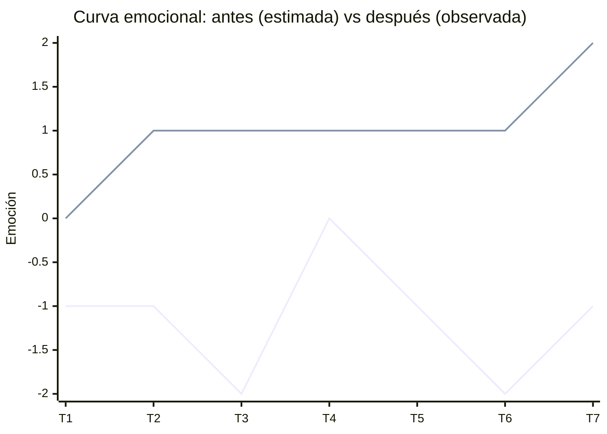

# Fase 4 · Prueba cognitiva (registro de sesión)

## Protocolo

| Campo | Valor |
|---|---|
| Fecha / hora | 28/10/2026 10:15 |
| Participante | Código seudónimo `EXT-01` (estudiante evaluador externo) |
| Moderador / observador | Carlos Giovanni Ramos (@carlitosgiovanniramos) / Henry Daniel Lagua (@Hlagua) |
| Prototipo | `prototipo/v1/` en http://localhost:8012/prototipo/v1/ |
| Dispositivo / ancho | Monitor calibrado / Emulación DevTools 360 px (Galaxy S20) |
| Consigna leída al participante (sin ayudas) | "Eres una investigadora que ayer no pudo terminar la sesión P-07. Retómala, deja el registro completo y cierra la sesión. Piensa en voz alta." |
| Criterio de éxito | La sesión queda "Cerrada" con 6/6 pasos y 4/4 obligatorios, sin ayuda del moderador |

## Registro v1

| Métrica | Valor observado |
|---|---|
| Tiempo total (mm:ss) | 03:45 |
| Errores (clics o acciones incorrectas) | 4 |
| Pausas > 5 s (dónde) | 2 (al ver mensaje genérico de error de cierre y al buscar qué faltaba en el checklist) |
| Resultado | ☑ Éxito con dificultad ☐ Éxito ☐ Fracaso |
| Cita textual del participante | "Le di a cerrar pero me dice que faltan obligatorios y no sé cuáles son porque todos los checkboxes se ven casi iguales con un simple asterisco." |

### Observaciones por touchpoint

| Touchpoint | Lo que hizo | Emoción observada (−2…+2) |
|---|---|---|
| T2 Localizar la sesión | Identificó la tarjeta P-07 con badge 'Interrumpida' rápidamente. | +1 |
| T3 Retomar | Pulsó 'Retomar', leyó el aviso y vio que los pasos 1-3 estaban guardados. | +1 |
| T5 Checklist | Leyó la lista, pero no distinguió con claridad obligatorios de opcionales. | -1 |
| T6 Cerrar (error) | Pulsó 'Cerrar sesión', apareció banner genérico; tardó en deducir que faltaba SUS y Grabación. | -2 |
| T7 Confirmación | Completó los datos y cerró, pero echó en falta un desglose antes de cerrar. | 0 |

## Hallazgo corregido en v2

| Campo | Contenido |
|---|---|
| Hallazgo **previsto (estimado)** | En v1 el error dice solo "hay ítems obligatorios pendientes": el participante debe adivinar cuáles (el asterisco es poco visible). Se espera una pausa larga o volver a pulsar "Cerrar sesión". |
| Hallazgo **observado** | El participante intentó hacer clic repetidas veces en "Cerrar sesión" y tuvo que leer uno por uno los 6 ítems para verificar cuál tenía asterisco. Confusión por falta de agrupación visual (Gestalt). |
| Issue | #3 |
| Corrección v2 | Región "Obligatorios · n de 4" con etiqueta textual, ítems faltantes resaltados con "— pendiente" y un error que **enumera** cada pendiente con un enlace que lleva el foco al control. |
| Evidencia antes / después | `evidencias/capturas/v1-error-360.png` → `evidencias/capturas/v2-error-360.png` |

## Re-prueba v2 (mismo participante u otro)

| Métrica | v1 | v2 | Tipo de mejora |
|---|---|---|---|
| Tiempo total | 03:45 | 01:50 | ☑ Demostrada (medida) ☐ Estimada |
| Errores | 4 | 0 | ☑ Demostrada ☐ Estimada |
| Pausas en el error | 2 (18s acumulados) | 0 (0s) | ☑ Demostrada ☐ Estimada |

> **Mejora demostrada** = medida en las dos versiones con participante externo EXT-01.

## Curva emocional después (observada en re-prueba)

